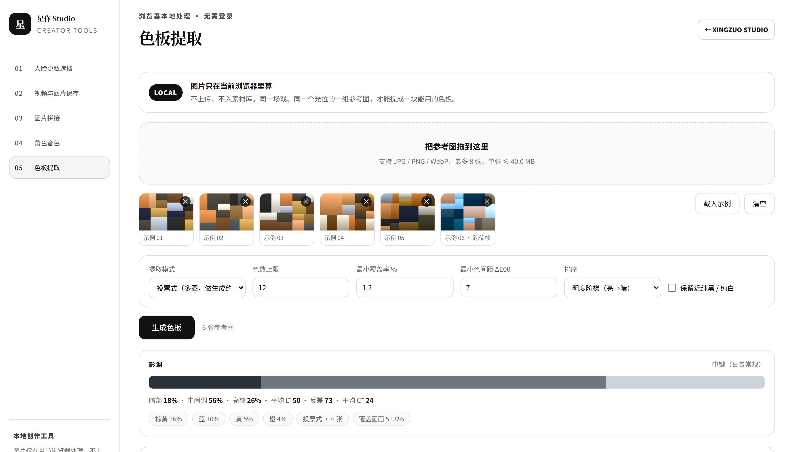
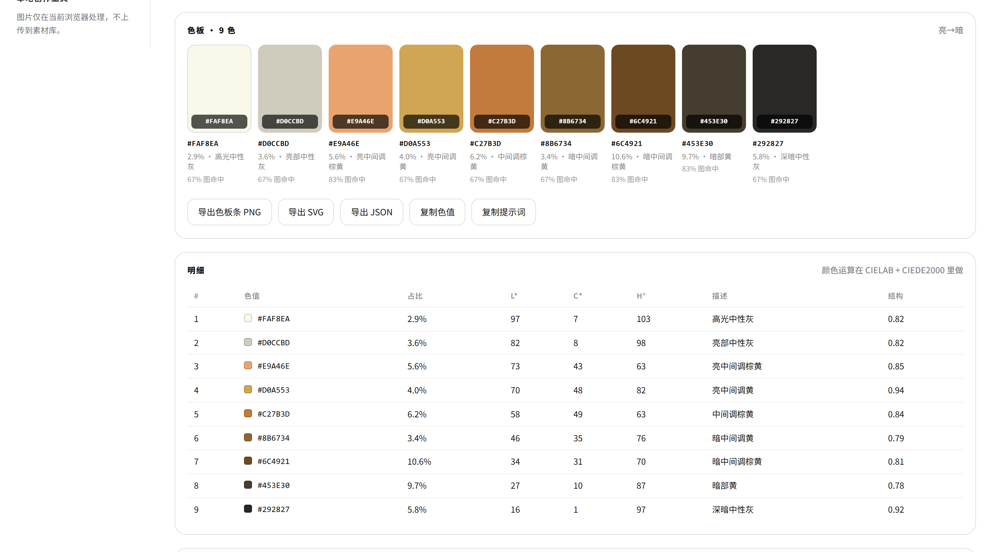
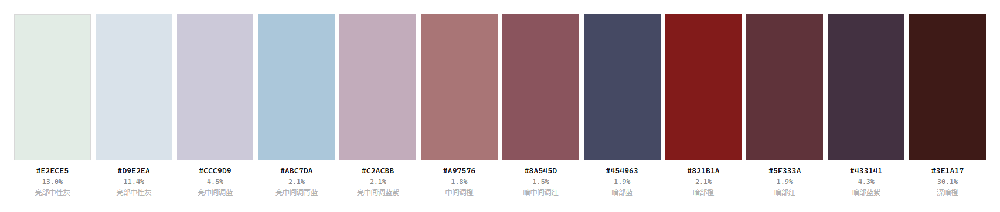
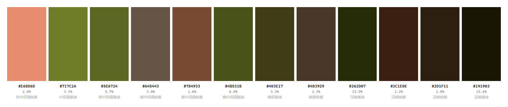
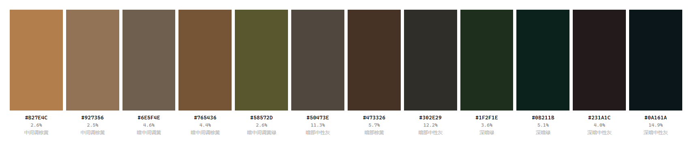

# 色板工坊 · Palette Forge


Turn a set of reference frames into the handful of hex values that actually hold a video model to a colour.

> 中文：给 AI 视频生成一个**可量化、可校验**的色彩约束。不是"电影感 / 暖调 / 高级灰"这种模型听不懂的词，
> 而是一组色值、一套影调结构，外加每条色为什么留下、为什么被剔除。

零依赖的**影视色板提取 / 体检 / 对账 / 校验**工具。给一批图或一段视频，一键出这种横条色板：

```
#F0ECDF 3.7% │ #B8C1CF 2.6% │ #BFB8A6 2.2% │ #EEA66F 4.9% │ #BF9643 5.0% │ #CC854B 7.3% │ ...
```



*实际界面：拖入一组参考图，设好参数，生成色板。同一场戏、同一个光位的图，才能提成一块能用的板。*



*每条色都带覆盖率、明度 L\*、饱和度 C\*、色相角 h° 和结构分数；被剔除的色连同理由单独列一张表。*

用途：给 AI 视频生成（可灵 / 即梦 / Runway / Vidu / Veo / Seedance）一个**可量化、可校验**的色彩约束，
而不是靠"电影感、暖调、高级灰"这种模型听不懂的词。

- 纯 Node.js，不需要 `npm install`，不需要 Python / numpy / PIL / sharp
- 颜色运算全部在 **CIELAB + CIEDE2000** 里做（不是 sRGB 欧氏距离），判"两个色像不像"跟人眼一致
- 自带纯 JS 的 PNG 编解码，没有 ffmpeg 也能读 PNG、出 PNG
- 有 ffmpeg 就能读 JPEG / WebP / 视频抽帧
- 所有图片都在本机处理，不上传任何地方

---

## 两个版本，同一个算法

| | 网页版 | 命令行版 |
|---|---|---|
| 文件 | `palette-forge.html` | `tools/forge.mjs` |
| 怎么用 | 双击用浏览器打开 | `node tools/forge.mjs ...` |
| 需要 | 一个现代浏览器 | Node 18+ |
| 适合 | 拖几张图，立刻看到色板 | 批处理、视频抽帧、接进流水线 |
| 额外能力 | 导出 PNG / SVG / JSON / 提示词 | 3D LUT、主色板对账、跑板校验、色板体检 |

网页版把图读进浏览器 `canvas`，全部计算在前端完成；命令行版走同一套判据，额外能处理视频。

---

## 30 秒上手

网页版：双击 `palette-forge.html`，把图拖进去，点「生成色板」。

命令行版：

```bash
cd palette-forge

node tools/forge.mjs demo        # 端到端演示：造 6 张锚定图 → 剔离群 → 提板 → 对账 → 出提示词
node tools/forge.mjs selftest    # 42 项离线自测

# 一组图 → 一块色板
node tools/forge.mjs extract ./refs/场景01_破窑_日/ --name 场景01 --formats png,svg,html,json,prompt,cube

# 单图 → 色板
node tools/forge.mjs extract keyframe.png --name 单帧

# 一段视频 → 色板（抽帧）
node tools/forge.mjs extract shot.mp4 --fps 0.5 --frames 20

# 体检一块已有的色板（判断能不能拿来当约束）
node tools/forge.mjs check data/catalog.json --palette master

# 与剧集主色板对账
node tools/forge.mjs anchor ./refs/场景01/ --master data/catalog.json --palette master

# 校验一条已生成的镜头有没有跑板
node tools/forge.mjs verify shot.mp4 --master data/catalog.json --palette master
```

---

## 示例色板

下面三块板都是这个工具直接产出的，色值、覆盖率、中文描述都来自实际计算。

### 低饱和灰调 · 室内日景



影调偏亮，冷灰与脏粉打底，只有一条 `#821B1A` 的暗红做重音。适合"安静的室内对话戏"——
大面积低饱和，让观众的注意力回到人身上。

### 土绿重暗部 · 野外夜戏



`#262D07` 和 `#191903` 两块深暗黄绿占了将近 40%，亮部只有一条 `#E68D6D`。典型的低键高反差：
所有东西都被压进暗部，火光或肤色是唯一的出口。

### 棕卡其 · 窑洞土墙



从 `#B27E4C` 的土黄一路压到 `#0A161A` 的近黑，中段全是低饱和的棕与灰。几乎没有色相跳动，
全靠明度拉开层次——土墙、麻布、煤灰这类材质堆出来的场景就该长这样。

---

# 一、出色板有四条路，选错了整件事就白做

| 模式 | 命令 | 什么时候用 | 出来的东西 |
|---|---|---|---|
| **单图** | `extract a.png` | 只想看"这一张"用了什么色 | 会过拟合这一张（把偶发高光当主色） |
| **池化** pooled | `extract <文件夹>` | 想知道"这一场戏实际是什么配色" | 被面积最大的那张图带着走 |
| **投票** voted | `extract <文件夹> --mode voted` | **要拿去做生成约束**（首选） | 只保留"多数镜头都在用"的骨架色 |
| **对账** anchor | `anchor <文件夹> --master X` | 已有剧集主色板，要判断这一场在不在体系内 | 主色在场/缺位清单 + 板外新色 |

**关键判断：做约束用 voted，做记录用 pooled。**

池化是把所有图的像素倒进一个池子统一聚类 —— 如果 20 张图里有 5 张是大远景（大面积天空占 60%），
池化出来的板会变成"天空色 + 一点点缀"，因为天空的面积票数压倒性多。
投票是每张图先各出一块小板（每张图 1 票），再按"出现在几张图里"过滤 ——
一张大远景只有 1 票，不会因为面积大就垄断。

---

# 二、哪些色要、哪些不要 —— 六条判据

这是整件事最难的部分。工具不靠"取前 12 名"这种粗暴规则，而是六条可解释、可复盘的判据：

### R1 覆盖面积：< 1.2% 的丢

阈值 `--min-coverage`（默认 1.2）。

低于这个面积的东西在视频生成里没有意义 —— 你没法用提示词约束一个只占 0.4% 画面的颜色，
模型也看不见它。这类通常是：边缘抗锯齿、JPEG 块效应、镜头光斑、偶发高光点、噪点。

> 例外：如果是一颗贯穿全片的"红色发带"，它可能只占 0.8% 但极其重要。
> 这时候用 `--min-coverage 0.3`，然后人工确认 —— 工具的职责是**报告**，不是替你决定。

### R2 感知唯一性：与已选色 ΔE00 < 7 的丢

阈值 `--min-sep`（默认 7）。这是"同一块颜色的重复采样"。

为什么必须做：`#F0EBE0` 和 `#E8E8DC` 的 ΔE00 只有 **2.7** —— 人眼上它们就是同一个奶油白。
把它们两条都留在色板里，你在提示词里写两遍同一个色，只会稀释其它色的权重。
**你给的两张参考图里就有这个情况**（第 1 张的 `#E8E8DC` / `#F0EBE0`，`check` 命令会直接指出来）。

ΔE00 的经验尺度：

| ΔE00 | 人眼感受 |
|---|---|
| < 1 | 完全看不出 |
| 1 ~ 2 | 并排能看出来 |
| 2 ~ 5 | 明显是两个色，但属于同一块 |
| 5 ~ 10 | 明确不同的两个色 |
| > 10 | 完全不同的色 |

### R3 极值截断：近纯黑/纯白默认丢

判据是 `L* < 4` 或 `L* > 97` 且 `C* < 4`。

理由：AI 出的图里，纯黑纯白绝大多数是**曝光产物或压缩产物**，不是美术决定。
你把它写进色板，等于告诉视频模型"画面里要有纯黑"——它就会给你死黑一片。

除非你确实在做一个"高对比剪影"的风格（`--keep-extremes`）。

### R4 结构分数：看它是不是"实体色块"

这是这套工具跟普通取色器最大的区别。每个候选色都会被回溯到画面上，回答一个问题：

> **这个色在空间上是一大块，还是碎成高频的小点？**

做法：把画面降成 96 列的网格，每格标到最近的色板色，然后算两个量 ——
- **邻接同色率**：相邻格子同色的比例（大色块高，噪点低）
- **最大连通域占比**：这个色最大的一块连片区域占它所有格子的比例

合起来就是 `结构分数`（0~1）：

| 分数 | 判定 | 意思 |
|---|---|---|
| > 0.6 | 实体色块 | 墙面、皮肤、服装、道具 —— **美术决定的，该留** |
| 0.35 ~ 0.6 | 中等结构 | 材质混合、明暗过渡带 —— 需要人看一眼 |
| < 0.35 | 低频碎块 | 沿边缘分布的高频噪声、降噪涂抹、HDR 光晕 —— **不是色，是伪影** |

加 `--strict` 会直接丢掉 < 0.35 的。

### R5 数量上限：12 色

上限 `--kmax`（默认 12）。

- 少于 6 色 → 约束太弱，模型自己补色，等于没约束
- 多于 14 色 → 提示词里塞不下，模型的注意力被摊薄，抓不住重点

推荐结构：**3 暗 + 4~5 中间调 + 2~3 亮 + 1~2 强调色**。

### R6 跨图投票：只出现在个别图里的丢

只用于 voted 模式。阈值 `--vote-ratio`（默认 40%）。

一张图里出现的特殊色可能是"这个镜头恰好拍到了一束光"，不是这一场的色彩规范。

### 还有一层：锚点完备度

`check` 命令会检查五个锚点。少一个，生成侧就会飘：

| 锚点 | 判据 | 缺了会怎样 |
|---|---|---|
| 肤色锚 | L* 52~82 / C* 10~45 / h 35~80 | **人物肤色不受控**，这是短剧最致命的 |
| 暗部锚 | L* < 25 | 暗部靠模型瞎编，容易死黑或发灰 |
| 亮部锚 | L* > 82 | 高光容易过曝到板外色 |
| 冷色锚 | b* < −6 或 h 200~330 | 没有冷暖对比，画面发平 |
| 暖色锚 | b* > 8 | 暖调质感立不住 |

---

# 三、从 Midjourney 到"这一场的色彩风格"：完整流程

### Step 0 · 出图姿势 —— 这一场 = 一个光位 = 一组图

**最常见的事故是把不同场景、不同光位的图混在一个文件夹里提板。**

色彩规范是跟**光位**走的，不是跟**剧情**走的。同一个破窑，日景侧光和夜内油灯是两套完全不同的
色彩规范，混在一起提出来的是"两者的平均"，那个东西约束不了任何一边。

正确做法：
- 一场戏建一个文件夹：`场景01_破窑_日/`
- 里面放同一场景、同一光位、不同机位/景别的 **12~20 张**
- MJ 里用 `--sref <风格参考图> --sw 80~120 --style raw` 锁住风格，**这一组里不要换 `--sref`**
- 宽高比贴近成片，避免裁剪改变构图占比

如果你是第一次做，先用 1 张图确定光位和色温，再用它做 `--sref` 出整组。

### Step 1 · 先剔离群，再提板

**别跳过这一步。** 直接从 20 张图提板 = 把 MJ 没锁住的那几张的跑偏色一起算进去了。

```powershell
node tools/forge.mjs verify "场景01_破窑_日\" --master 场景01_破窑_日\anchor.json
```

`verify` 给每张图打分：

```
吻合分  在板%  离板%   判定
    96   91.2      0   吻合：可以直接进剪辑
    58   30.6   15.1   基本吻合：加一点校色即可
    31    2.2   39.6   严重跑板：建议重生成   ← 删掉
```

- **吻合分 ≥ 75** → 留
- **50 ~ 75** → 留，但注意它会带一点偏
- **< 50 或 离板像素 > 25%** → 删

没有主色板时怎么办？先对**整个文件夹**跑一次 `extract`，把结果存成 `anchor.json`，
再逐张 `verify`。这一步叫"用自己的一阶结果找自己的离群点"，很有效。

### Step 2 · 提板

```powershell
node tools/forge.mjs extract "场景01_破窑_日\" --mode voted --kmax 12 --name 场景01
```

### Step 3 · 与剧集主色板对账

```powershell
node tools/forge.mjs anchor "场景01_破窑_日\" --master data/catalog.json --palette master
```

输出的三种结论，分别对应三个决策：

| 结论 | 含义 | 决策 |
|---|---|---|
| 主色「在场」 | 这场戏在主色板体系内 | 直接复用主色 hex，保证跨场连续 |
| 主色「缺位」 | 这场戏确实没用到这个色 | 正常。夜景没有骨白高光是对的 |
| 离板像素高（> 8%） | 冒出了板外新色 | **必须人工判断**：是真需要（火焰/霓虹/新场景），还是 MJ 跑偏了 |

离板色的聚类结果会单独列出来 —— 那才是"该不该往主板上加色"的证据，
而不是拍脑袋觉得"应该有块红的"。

### Step 4 · 体检 + 定稿

```powershell
node tools/forge.mjs check out\场景01\palette.json
```

修掉 `issues` 里的冗余色和锚点缺失，然后存成剧集资产：

```json
{
  "palettes": {
    "master":    { "colors": [...] },          // 全剧
    "s01-day":   { "colors": [...] },          // 第 1 场日景变体
    "s01-night": { "colors": [...] }           // 第 1 场夜景变体
  }
}
```

到第 30 场的时候你手上就是一套**可复用的体系**，而不是 30 块互相打架的色板。

---

# 四、生成侧怎么真正用上这块色板

色板提出来只是原料，真正约束住生成需要四层一起上：

### 第 1 层 · 提示词（工具已自动生成 `prompt.txt`）

**直接把 hex 丢给视频模型基本没用** —— 模型没有 hex 的语义。必须翻译：

```
Shot color palette: warm bone #F0EBE0, cool slate blue #B8C1CF, ochre #BF9643,
burnt sienna #CC854B, deep umber #6D4824, near-black #282827, midnight navy #1B2339.
Limited 7-color palette, earthy ochre-dominant (棕黄 87%), medium key (shadows 17% /
midtones 59% / highlights 24%), cohesive cinematic color grading, muted desaturated
tones, no saturated primaries, no neon, no pure white background.
```

三个要素缺一不可：
1. **色值 + 人话名**（`ochre #BF9643` 比光给 hex 强很多）
2. **主次比例**（告诉模型哪个是主角，哪个是配角）
3. **影调结构**（暗部/中间调/亮部各占多少 —— 这决定了画面的"重量感"）

再加反向词：`oversaturated, neon, rainbow, high-chroma primaries, HDR halos, oversharpened`

### 第 2 层 · 参考图

**把色板条 `palette.png` 本身**塞进风格参考（sref / style reference / 参考图）——
比纯文字有效，因为很多模型真的能读色块分布。

更有效的是**拿这一场的关键帧做首帧图生视频**（i2v）—— 首帧把色彩和构图一起锁死，
这时候色板的作用是"筛选用哪一张关键帧"，不是"控制生成"。

### 第 3 层 · 后处理 LUT（`--formats cube`）

`extract` 加 `--formats ...,cube` 会输出一个 `.cube` 3D LUT，作用是把任何画面**吸附到色板上**：

```powershell
ffmpeg -i shot.mp4 -vf lut3d=场景01.cube -c:a copy shot-graded.mp4
```

吸附原理：每个像素在 Lab 里找最近的主色，按距离开方衰减地拉过去：

```
w = strength × tolerance / (tolerance + ΔE)     ← 距离 0 时拉满，越远拉得越少
new = lab + (target − lab) × w
```

`--lut-strength` 控强度（默认 0.8），`--lut-tolerance` 控吸附半径（默认 ΔE 14，调大拉得更狠但画面更平）。

实测（把一帧刻意冷偏 22 个 b* 单位的画面拉回示例主色板）：

| 强度 | 容差 | 离板像素 | 在板像素 | 吻合分 |
|---|---|---|---|---|
| — | — | 37.9% | 4.3% | 33（校色前） |
| 0.7 | 10 | 23.4% | 22.0% | 49 |
| 0.8 | 14 | 22.0% | 32.3% | 55 |
| 1.0 | 16 | 19.9% | 41.2% | 61 |

所以：默认参数用于"轻微校正"；跑偏很严重时 `--lut-strength 1.0 --lut-tolerance 16` 能拉回更多，
但画面会更"平"。

DaVinci Resolve / Premiere 也能直接加载。

> 注意：LUT 是**救急**，不是最优解。它救得回色偏，救不回"光位不对"。
> 优先让生成侧对上，再考虑 LUT。

### 第 4 层 · 闭环校验（这是最有价值的一层）

生成完的镜头，**跑一遍 verify**：

```powershell
node tools/forge.mjs verify shot.mp4 --master data/catalog.json --palette master
```

```
吻合度得分: 94/100 — 吻合：可以直接进剪辑
像素分布: 在板上(ΔE00≤6) 91.2% / 过渡带 8.5% / 离板(>12) 0.3%
平均偏离 ΔE00: 1.2

  色值      本镜头占比   该色在板占比   平均ΔE00
  #F0EBE0     21.6%        96%          0.6
  ...
```

评分不是用"平均 ΔE00"，而是用**分布**：
`score = 100 × (在板占比 + 0.5 × 过渡带占比)`

为什么不用平均值：真实画面里渐变、明暗过渡、材质混合**必然**产生大量中间色。
用平均值打分会把正常镜头判成跑板 —— 这是这类工具最常见的标定错误。

闭环的意思：`score < 55` 且 `离板 > 15%` → 重生成；`55 ~ 75` → 上 LUT 拉回来。

---

# 五、参数速查

| 参数 | 默认 | 什么时候改 |
|---|---|---|
| `--mode` | pooled | 做约束改 `voted` |
| `--kmax` | 12 | 想更严格就 8，想保留更多层次就 14 |
| `--min-coverage` | 1.2（%） | 有重要小面积道具时降到 0.3~0.5 |
| `--min-sep` | 7（ΔE00） | 想出"细节更丰富"的板降到 5；想更干净升到 9 |
| `--merge-de` | 3 | 默认就够，除非色板里全是同一色调 |
| `--order` | value | `value` 明度阶梯（给人看影调）/ `hue` 按色相 / `coverage` 按重要性 |
| `--keep-extremes` | 关 | 刻意要纯黑纯白风格（剪影、版画）时开 |
| `--drop-extremes` | 关 | 采样阶段就剔掉，适合有大片死黑的夜景 |
| `--strict` | 关 | 结构分数 < 0.35 直接丢，适合素材质量参差时 |
| `--roi x,y,w,h` | 全画面 | 躲开天空/字幕/大面积人脸（0~1 比例） |
| `--vote-ratio` | 40（%） | 图少（<5 张）时降到 30 |
| `--near-de` / `--off-de` | 6 / 12 | verify 的分布阈值 |

**ROI 是个被低估的参数。** 一个全景镜头里天空占 40%，那 40% 会把色板的中心拽向蓝色。
`--roi 0,0.15,1,0.75` 先砍掉顶部 15% 和底部 10%，出来的板会明显更接近"人在看的那个部分"。

---

# 六、命令参考

```
node tools/forge.mjs extract <图片|文件夹|视频...> [选项]   一组图/单图 → 色板
node tools/forge.mjs analyze <输入...>                      只出影调分析 + 全量候选色（含被剔的）
node tools/forge.mjs anchor  <输入...> --master <色板>      与主色板对账
node tools/forge.mjs verify  <输入...> --master <色板>      校验是否跑板
node tools/forge.mjs check   <色板文件>                     色板体检
node tools/forge.mjs check   --hex "#112233 #445566"        直接体检一串 hex
node tools/forge.mjs demo                                   端到端演示
node tools/forge.mjs selftest                               离线自测（42 项）
node tools/forge.mjs help                                   全部参数
```

**输出文件**（`out/<名字>/`）：

| 文件 | 用途 |
|---|---|
| `palette.png` | 横条色板图，带 hex 和占比（就是你给的那种图） |
| `palette.svg` | 矢量版，可无级缩放，能带中文标注 |
| `palette.html` | 联络表：色块 + 影调分布条 + 被剔除候选色及理由 |
| `palette.json` | 全量数据（Lab / LCh / 覆盖率 / 结构分数 / 剔除理由） |
| `prompt.txt` | 中英双语提示词片段 + 反向词 |
| `palette.cube` | 3D LUT（`--formats` 里加 `cube`） |
| `palette.hex.txt` | 一行空格分隔的 hex，方便粘贴 |

---

# 七、为什么是 Lab / ΔE00，不是 RGB

在 sRGB 里算欧氏距离判断"两个色像不像"是错的，因为 sRGB 不是感知均匀空间：

- sRGB 的 `#000000 → #202020` 看起来变化巨大，`#E0E0E0 → #FFFFFF` 几乎看不出差别，
  但两组的数值距离一样大
- 绿色通道的权重被严重低估

CIELAB 把颜色拆成 `L*`（明度）/ `a*`（绿-红）/ `b*`（蓝-黄），是刻意设计成感知均匀的。
CIEDE2000 在上面再修一层，处理了蓝色区域的感知特殊性、明度与饱和度的交互等。
本工具的自测里跑了 **Sharma 等人 2005 年的 13 组标准测试数据**，误差 < 0.0002 ——
也就是说色差计算是跟国际标准对齐的，不是自己发明的公式。

排序用的是 `L*` —— 所以色板条天然就是一条**明度阶梯**，从最亮到最暗。
这正好是人眼看影调的顺序，也是你给的那两张参考图的做法。

---

# 八、已知限制

| 限制 | 说明 | 绕法 |
|---|---|---|
| 无主体分割 | 不知道哪块是人、哪块是背景 | 用 `--roi` 手动框；后续可接分割模型 |
| 视频抽帧不看镜头切点 | 按 fps 均匀抽，可能抽在转场上 | `--fps` 调低；或在剪辑侧先导出关键帧 |
| 假设 sRGB | 不处理 HDR / P3 / Log 素材 | 先用 ffmpeg 转 sRGB 再喂进来 |
| LUT 会损失层次 | 吸附式映射 | `--lut-strength` 降到 0.4~0.5 |
| 大图慢 | 纯 JS，无 SIMD | 默认已经降到 512px 宽再算，通常 < 1s/张 |
| 结构分数是启发式 | 不是分割，是连通域统计 | 0.35~0.6 的中间地带需要人看 |

---

# 九、参考色板

`data/catalog.json` 里放了一套示例：`master`（12 色主色板）、`scene-variant`（13 色场景变体）和 `union`（并集），
可以直接拿来试 `check` 和 `anchor`：

```bash
node tools/forge.mjs check data/catalog.json --palette master
```

体检结果（评分 88/100）：

```
需要处理：
  1. 1 组冗余色（ΔE00 < 5）：#F0EBE0≈#E8E8DC(2.7) —— 至少要砍掉一条

没问题：
  · 12 色，数量合适
  · 明度阶梯连续，没有大断层
锚点完备度：5/5  skin✓ shadow✓ highlight✓ cool✓ warm✓
```

> 这套示例色值是从参考图上标注的 hex 直接读的。换成你自己的项目时，建议用真实截图跑一遍
> `extract` 重新提一次 —— 标注可能有四舍五入，也可能和画面实际像素有偏差。

---

## 目录结构

```
palette-forge/
├── palette-forge.html   单文件网页版（双击即用，零依赖）
├── tools/
│   ├── forge.mjs        CLI 入口
│   ├── color.mjs        色彩数学（sRGB⇄Lab⇄LCh、CIEDE2000）
│   ├── png.mjs          纯 JS PNG 编解码 + 5x7 点阵字库 + 画布
│   ├── decode.mjs       ffmpeg 落盘式解码（图片/视频抽帧）
│   ├── engine.mjs       提取引擎（聚类/留舍判据/结构分数/对账/校验/体检）
│   ├── render.mjs       输出（PNG/SVG/HTML/.cube/提示词）
│   ├── card.mjs         从色板目录直接渲一张色卡
│   ├── demo.mjs         端到端演示
│   └── selftest.mjs     离线自测（42 项）
├── data/catalog.json    示例色板目录
├── docs/screenshots/    README 里用到的界面与示例图
└── out/                 产出目录（已 gitignore）
```

---

## 许可

Apache License 2.0，见 `LICENSE` 与 `NOTICE`。这是个人项目，没有任何第三方运行时依赖，
`THIRD_PARTY.md` 里有逐项说明。

色值本身不受版权保护，你可以把自己项目的色板直接放进 `data/catalog.json` 一起用。

